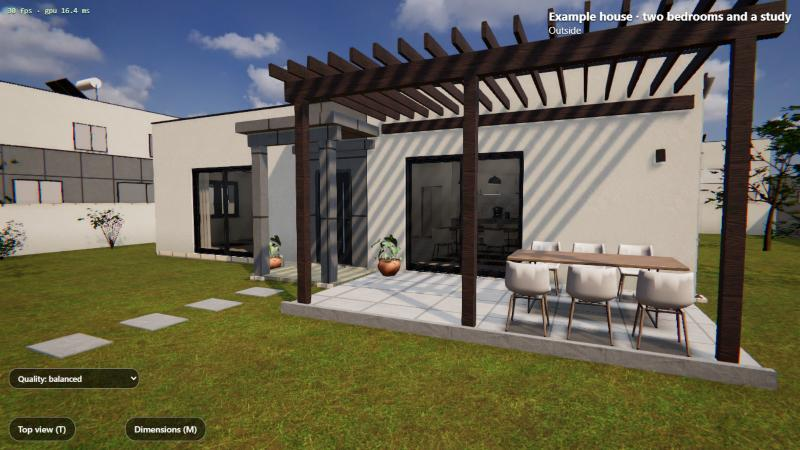
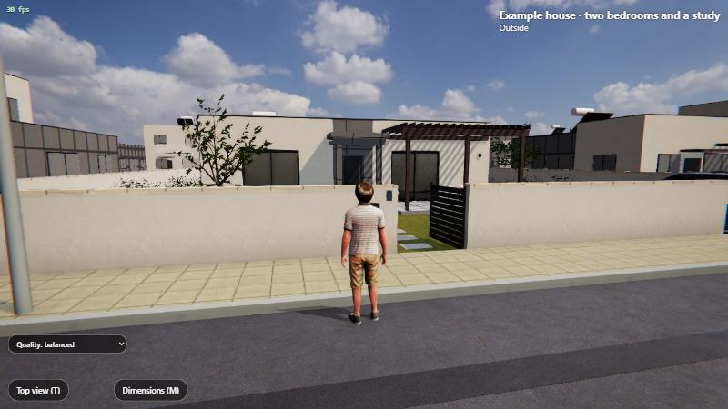
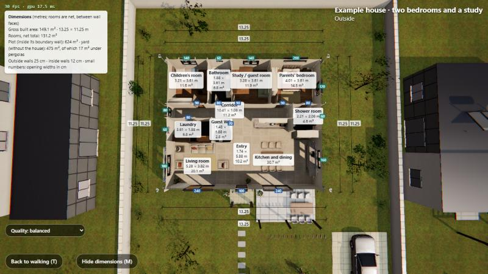
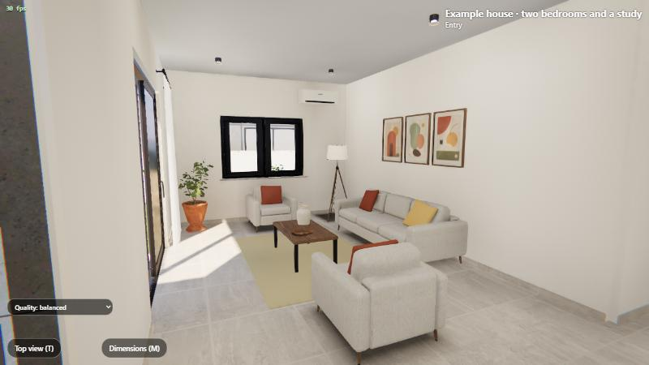

<div dir="rtl">

# House Walk Kit – מתכנית קומה לבית שאפשר להסתובב בו

[English](README.md)

הופכים תכנית קומה – או סתם רעיון לבית – לבית שאפשר להסתובב בו בדפדפן, ו־[Claude Code](https://claude.com/claude-code)
(או סוכן קוד אחר) עושה את העבודה. נותנים לו צילום או PDF של תכנית, תיאור, או כלום; בערך רבע
שעה אחר כך נכנסים מהדלת הראשית, פותחים דלתות, מסתכלים מהחלונות ורואים כל חדר מלמעלה עם המידות
שלו.






זה שני דברים במאגר אחד:

- **פרויקט תבנית** (three.js + Vite): אור שמיים אמיתי, אור פנים מחושב מראש, ריהוט מספרייה של
  מודלים חופשיים, רחוב ושכונה, גוף ראשון ושלישי, מבט מלמעלה עם הגג חתוך, מידות אדריכליות,
  ג'ויסטיקים בטלפון, אנגלית ועברית.
- **תוסף ל־Claude Code** (`house-walk`) עם כישורים (skills) שמקימים את הפרויקט, קוראים את
  התכנית, בודקים אותה, מעצבים חלופות, מצלמים, משפרים מהירות ומפרסמים (רק כשאתם אומרים).

התכניות שלכם נשארות במחשב שלכם. שום דבר לא עולה לרשת אלא אם ביקשתם.

## הדרך הכי מהירה: הודעה אחת

לא צריך להתקין כלום קודם. פותחים **תיקייה ריקה** ב־Claude Code (לשונית Code באפליקציה למחשב,
הטרמינל או VS Code), מצרפים תכנית קומה אם יש, ושולחים:

</div>

```text
תבנה לי מודל תלת־ממדי של הבית שלי שאפשר להסתובב בו, עם https://github.com/itamaroh7/house-walk-kit
```

<div dir="rtl">

או בלי שרטוט:

</div>

```text
תבנה לי בית תלת־ממדי שאפשר להסתובב בו עם https://github.com/itamaroh7/house-walk-kit – 3 חדרי שינה,
מטבח פתוח וגינה עם פרגולה.
```

<div dir="rtl">

הסוכן קורא את [AGENTS.md](AGENTS.md), מתקין מה שחסר (Node.js, ‏Git), מוריד את הפרויקט ואת
המודלים, מתכנן את הבית, בודק אותו ופותח אותו בדפדפן. הוא שואל רק מה שהשרטוט לא אומר (מידה אחת,
איזה צד פונה לרחוב).

**לשלוח לחברים** (העתיקו והדביקו):

</div>

```text
רוצים להסתובב בבית שלכם בתלת־ממד? פתחו תיקייה ריקה ב־Claude Code (claude.com/claude-code),
צרפו צילום של תכנית הקומה (או פשוט תארו את הבית), וכתבו:
"תבנה לי מודל תלת־ממדי של הבית שלי שאפשר להסתובב בו, עם https://github.com/itamaroh7/house-walk-kit"
```

<div dir="rtl">

## מה צריך

- **Claude Code** (אפליקציה למחשב, טרמינל או VS Code) עם מנוי **Claude Pro, Max, Team או
  Enterprise** – או סוכן קוד אחר שמריץ פקודות במחשב (הוא עובד לפי [AGENTS.md](AGENTS.md)). צ'אט
  רגיל (claude.ai,‏ ChatGPT) לא יכול: הבית רץ כשרת אינטרנט קטן על המחשב.
- **Node.js 18.17 ומעלה** ו־**Git**: הסוכן בודק אותם ומתקין מה שחסר (ייתכן שתתבקשו לאשר את
  ההתקנה). ידנית: Windows‏ `winget install OpenJS.NodeJS.LTS` ו־`winget install Git.Git`;
  macOS‏ `brew install node git`; Linux – מנהל החבילות או [nvm](https://github.com/nvm-sh/nvm).
- מחשב עם כרטיס גרפי סביר (מחשב נייד עם Intel Iris Xe מריץ אותו ב־60 פריימים בשנייה) וכ־500 MB
  פנויים.

## התקנת התוסף (לא חובה, לשימוש קבוע)

התוסף מוסיף כישורים מוכנים (`/house-walk:new`, `/house-walk:check`, `/house-walk:variants`...)
כך ש־Claude Code יודע את הדרך בלי לקרוא קודם את המאגר.

**טרמינל (CLI):**

</div>

```bash
claude plugin marketplace add itamaroh7/house-walk-kit
```

```bash
claude plugin install house-walk@house-walk-kit
```

<div dir="rtl">

(או בתוך שיחה: `/plugin marketplace add itamaroh7/house-walk-kit` ואחר כך
`/plugin install house-walk@house-walk-kit`)

**אפליקציה למחשב:** מוסיפים את ה־marketplace פעם אחת מטרמינל (הפקודה הראשונה למעלה, או
`/plugin marketplace add itamaroh7/house-walk-kit` בכל שיחה של Claude Code), ואז בלשונית Code
לוחצים **+** ליד תיבת ההודעה, **Add plugins**, בוחרים **house-walk** ומתקינים.

**VS Code:** כותבים `/plugins` בתיבת ההודעה של Claude Code; בלשונית **Marketplaces** מוסיפים
`itamaroh7/house-walk-kit`, ובלשונית **Plugins** מוצאים את **house-walk** ולוחצים **Install**.

## התחלה בחמש דקות (עם התוסף)

1. יוצרים תיקייה ריקה ופותחים אותה ב־Claude Code.
2. כותבים: **"תבנה לי בית תלת־ממדי שאפשר להסתובב בו מתכנית הקומה הזו"** ומצרפים את התכנית
   (צילום, סריקה או PDF), רצוי עם מידה אחת שאתם יודעים ("הסלון ברוחב 5.4 מטר") – או מתארים את
   הבית, או פשוט "תפתיע אותי".
3. עונים על שאלה או שתיים, אם יש (איזה צד פונה לרחוב, איפה הצפון).

Claude מתקין מה שחסר, מקים את הפרויקט, מוריד את הנכסים התלת־ממדיים (כ־130 MB, פעם אחת), ואז
מתכנן, בודק ומראה לכם את הבית.

**למה לצפות:** בערך 10–15 דקות עד הבית הראשון (נמדד: הקמה, תכנון ובדיקה), ועוד 1–5 דקות בכניסה
הראשונה, שבהן מחושב אור הפנים. אחר כך כל שינוי לוקח דקות: "תזיז את דלת המטבח 50 ס"מ מזרחה", "תגדיל את חדר
הילדים", "תראה לי שלוש גרסאות עם הגינה במערב".

### נסו את זה (העתיקו והדביקו)

</div>

```text
תבנה לי בית תלת־ממדי שאפשר להסתובב בו מתכנית הקומה המצורפת. הסלון ברוחב 5.4 מטר.
הרחוב בתחתית השרטוט והצפון למעלה. תענה לי בעברית.
```

<div dir="rtl">

## הכישורים

| כישור | מה הוא עושה |
|---|---|
| `/house-walk:new` | מקים פרויקט בתיקייה ריקה (תבנית, npm install, נכסים, שרת פיתוח, הבית לדוגמה) |
| `/house-walk:from-plan` | תמונה/PDF של תכנית + מידה אחת ← קובץ תכנית, בדוק, עם אור מחושב, מוצג |
| `/house-walk:check` | בדיקות ערכת התכנית והבדיקה המלאה בדפדפן, ומתקן את מה שנכשל |
| `/house-walk:variants` | כמה חלופות תכנון לפי האילוצים שלכם, עם טבלת שטחים |
| `/house-walk:tour` | מבט מלמעלה, תמונות בגובה העיניים ומקרא המידות, נשלחים כתמונות |
| `/house-walk:perf` | זיכרון גרפי וזמן פריים, והתיקונים המוכרים |
| `/house-walk:share` | בונה אתר סטטי; מעלה לרשת רק אחרי שאמרתם כן (סיסמה לבחירה) |

כמעט אף פעם לא צריך להקליד אותם: Claude בוחר את הכישור המתאים לפי מה שביקשתם. היוצא מן הכלל
הוא `share`, שרץ רק כשמקלידים אותו.

## בתוך הבית

| מקש | |
|---|---|
| W A S D / חיצים | הליכה (Shift: ריצה, Space: קפיצה) |
| עכבר | הסתכלות (לחיצה על התמונה נועלת את העכבר) |
| E | פתיחה וסגירה של הדלת הקרובה |
| V | גוף ראשון / שלישי |
| T | מבט מלמעלה עם הגג חתוך (גרירה – סיבוב, גלגלת – זום, WASD – הזזה) |
| M | מידות: גודלי חדרים, מידות חוץ, שטחים |
| H | הסתרת העזרה |

בטלפון או בטאבלט: הג'ויסטיק השמאלי מזיז (עד הקצה – ריצה), הימני או גרירה מסובבים, וכפתורים
פותחים דלתות ומחליפים מבט.

**תפריט האיכות** (למטה בצד): *מהירה* (יותר פריימים, בלי הצללת סביבה, יכולה לרדת ל־70%
רזולוציה), *מאוזנת* (ברירת המחדל) או *גבוהה* (הכי חדה, לא מורידה רזולוציה). הבחירה נשמרת
בדפדפן.

מוסיפים `?lang=he` או `?lang=en` לכתובת כדי להחליף שפה; עברית נבחרת לבד כשהדפדפן מעדיף עברית.

## ידנית (בלי סוכן)

</div>

```bash
git clone https://github.com/itamaroh7/house-walk-kit my-house
cd my-house
npm install
npm run assets
npm run dev
```

<div dir="rtl">

ואז פותחים את <http://127.0.0.1:5180/>. התכניות נמצאות ב־`src/plans/` (ראו
`src/plans/example.js` ו־[CLAUDE.md](CLAUDE.md) לפורמט); `npm run check` בודק אותן.

## עדכון

</div>

```bash
claude plugin update house-walk@house-walk-kit
```

<div dir="rtl">

תוספים מ־marketplace קהילתי לא מתעדכנים לבד. פרויקט שכבר יצרתם ממשיך לעבוד כמו שהוא; מה חדש
בתבנית – ב־[CHANGELOG.md](CHANGELOG.md).

## פתרון בעיות

- **"המודלים התלת־ממדיים עוד לא כאן"**: מריצים `npm run assets` בתיקיית הפרויקט. מאחורי proxy
  או בלי רשת: מורידים את קובץ ה־zip של החבילה מדף ה־Releases ומריצים
  `npm run assets -- --from <zip>`.
- **"SHA-256 ... expects ..."**: ההורדה נפגמה או שהיא של גרסה אחרת; מריצים שוב.
- **תקוע על "מחשב את האור בבית"**: בכניסה הראשונה לתכנית שהשתנתה האור מחושב מחדש (1–5 דקות;
  לאט יותר בכרטיס גרפי חלש). השאירו את הלשונית גלויה – הדפדפן מאט לשוניות ברקע.
- **הדף איטי או מפוקסל**: בחרו *מהירה* בתפריט האיכות; סגרו לשוניות כבדות אחרות; במחשב נייד
  חברו לחשמל (הכרטיס הגרפי מאט על סוללה).
- **תיבה אדומה "בתכנית יש בעיות"**: ערכת התכנית מצאה משהו לא תקין (חלון שלא על קיר, חדר שינה
  בלי אור יום...). בקשו מ־Claude לתקן, או הריצו `npm run check`.
- **`npm install` נכשל על `sharp`**: הוא נחוץ רק להוספת מודלים חדשים; עדכנו את Node.js לגרסת
  LTS ונסו שוב.
- **פורט 5180 תפוס**: Vite בוחר את הפורט הפנוי הבא; השתמשו בכתובת שהוא מדפיס.

## פרטיות

הכול רץ במחשב שלכם. תכניות הקומה, קובצי התכנית והצילומים לא נשלחים לשום מקום על ידי הערכה הזו
(Claude עצמו רואה את מה שאתם משתפים בשיחה, כרגיל). ההורדה היחידה היא חבילת הנכסים מדף ה־Releases
של המאגר הזה. פרסום אתר קורה רק כשאתם מבקשים ומאשרים.

## קרדיטים ורישיונות

קוד: MIT ‏([LICENSE](LICENSE)). נכסים תלת־ממדיים: Poly Haven ו־ambientCG ‏(CC0), Microsoft
Rocketbox ‏(MIT), ez-tree ‏(MIT), three.js ‏(MIT) – כל נכס מפורט ב־[LICENSES.md](LICENSES.md).

</div>
